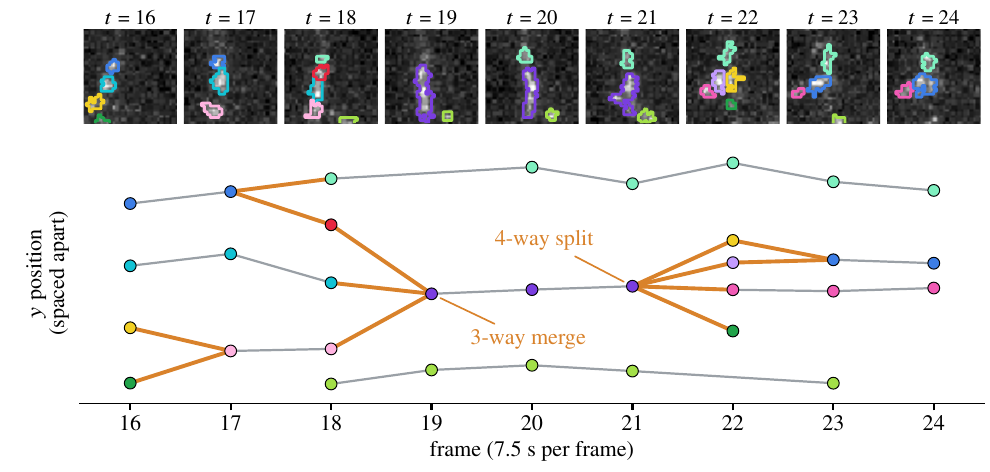

# Ramu Gautam

### Deep Learning for 3D Live Microscopy · Tracking, Segmentation, Scientific Software

📍 Las Vegas, NV

**I build models that follow protein clusters through time, including the moments when they split and merge.**

Ph.D. candidate in Electrical Engineering at the University of Nevada, Las Vegas. I work on the whole chain,
from the transformer that scores a link to the desktop app a biologist double-clicks, to the finding that comes out the other end.

7 publications · 270+ citations · one published tool, two models in the pipeline

  

Par-3 puncta in a *Drosophila* embryo over about a minute, and the lineage ProTrackFormer recovers from them. A three-way merge and a four-way split, three frames apart. Most trackers cannot represent either event.

---

## Building

| Project | What it is |
|---------|------------|
| **[ProTrack3D](https://github.com/ramugautam1/ProTrack3D-v2)** | A desktop app for Windows, Mac and Linux that finds protein clusters in 3D time-lapse images, follows each one through time, reports when they split, merge, appear and disappear, and makes the plots. You give it a movie, it gives you masks, tracks, lineage graphs and tables. No coding needed, no GPU required. Published in *BMC Bioinformatics* (2026); version 2 ships the two models below. |
| **[ProTrackFormer](https://github.com/ramugautam1/protrackformer)** | A transformer tracker for objects whose histories are graphs, not trees. Every candidate link is scored on its own, so merges are never suppressed; every object predicts how many parents and children it has; one exact integer program decodes a consistent lineage. Split and merge F1 of 0.71 and 0.73, against at most 0.47 and 0.59 for overlap tracking, LAP, Ultrack and Trackastra on the same benchmark. |
| **[ProSegFormer](https://github.com/ramugautam1/prosegformer)** | A 3D segmenter for objects four to six pixels wide. It never downsamples the depth axis, attends at full in-plane resolution, and is pretrained on unlabeled recordings with masked-image modeling. Instance F1 of 0.89 against 0.82 for nnU-Net. **ProSegFormer-Lite** drops attention, keeps the accuracy, and fits in 1.0M parameters. |

## Research

| | |
|---|---|
| **The problem** | Protein clusters are a few hundred nanometers across, move about half their width per frame, and fuse and divide constantly. Cell trackers are built for division trees and discard merges by design. Segmenters built for organs and nuclei downsample until the clusters vanish. |
| **Benchmarks** | Two lineage benchmarks with 463 hand-judged split and merge events, in an extended Cell Tracking Challenge format. 
| **Evaluation** | Paired bootstrap intervals, multi-seed ablations, object-level metrics in physical units. Training recipe, full resolution and pretraining.|
| **Biology** | An event-aligned analysis of multi-channel protein (Gish-Myo) datasets show Myosin level rise before Gish puncta fuse. |

## Selected papers

- **R. Gautam**, Y. Jiao, Y. Pang, M. Weng, M. Yang. [ProTrack3D: a comprehensive tool for segmentation and tracking of proteins with split and fusion](https://doi.org/10.1186/s12859-025-06307-w). *BMC Bioinformatics* 27:4, 2026.
- **R. Gautam**, B. Lin, M. Yang. Few-shot learning for detecting affective states from keyboard and mouse data. *IEEE DSAA*, 2024.
- **R. Gautam**, Y. Jiao, M. Weng, M. Yang. Deep learning based method for segmentation, tracking, and analysis of intracellular proteins and their interactions. *IEEE BIBE*, 2022.
- **R. Gautam**, N. Kumar, J. G. Lynam. Theoretical and experimental study of choline chloride-carboxylic acid deep eutectic solvents and their hydrogen bonds. *Journal of Molecular Structure*, 2020. My most cited paper, from earlier work in materials science.

ProTrackFormer and ProSegFormer manuscripts are in preparation. Full list on [Google Scholar](https://scholar.google.com/citations?user=mowxK1cAAAAJ&hl=en).

## Background

| | |
|---|---|
| **Now** | Graduate Research Assistant, UNLV: transformers for multi-object tracking through splits and merges, self-supervised 3D segmentation, benchmarks and evaluation for live microscopy. Instructor of record for Digital Systems Architecture and Design, 2026; Best Teaching Assistant Award, 2025. |
| **Before** | Java developer at USAA, building and testing REST APIs with CI/CD and code review · few-shot affect detection from keyboard and mouse data · NSF ITEST outreach bringing girls in grades 6 to 12 into engineering (*IEEE TALE*, 2022) |
| **Earlier** | M.S. in Molecular Science and Nanotechnology, Louisiana Tech, working on deep eutectic solvents · B.E. in Electronics and Communication Engineering, Tribhuvan University |

**Stack:** PyTorch · MONAI · NumPy / SciPy / scikit-image · HiGHS (integer programming) · Qt / PySide6 · Python, C, C++, Java · SystemVerilog · Linux

---

### Let's talk

I am interested in deep learning for biological and biomedical applications: segmentation and tracking in
3D and time-lapse microscopy, self-supervised learning on unlabeled recordings, and evaluation that holds up.
If you work with cells, organelles, puncta or anything else that moves, fuses and divides under a microscope,
I would like to hear from you, and to hear what breaks when you run my code on it.

*A number without an interval is not a result.*

